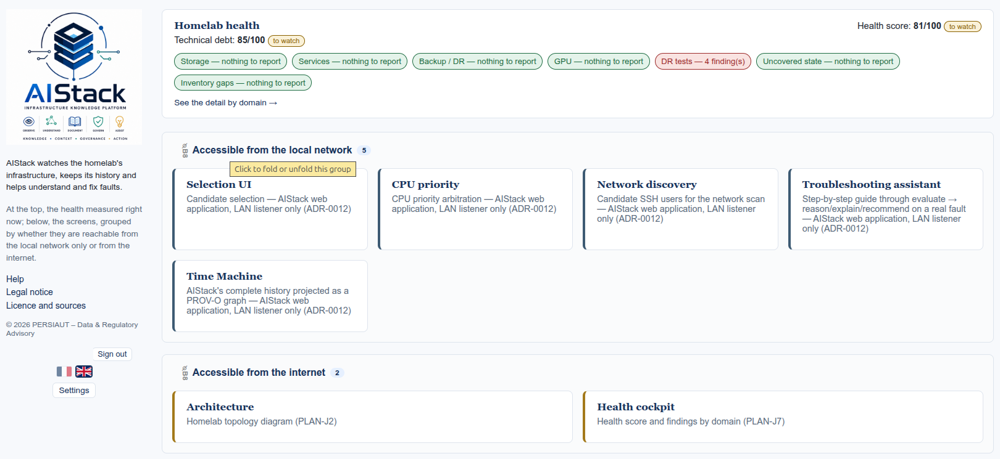

# AIStack

[](LICENSE.txt)

**AIStack watches a self-hosted server and explains it**: what runs, what
changed, what is at risk, and what to do about it. It runs on the server it
observes, as one Docker image and seven services.

Its idea: an infrastructure is understood and handed on only if what is known
about it is kept dated, sourced and explained, never overwritten. AI helps
reason about a fault; it is never the source of truth.

## What it does

- **Console** — one page leading to every screen, with the version, the
  health score and a mark on each card where something waits for you.
- **Health cockpit** — storage, services, backups and restore tests, GPU,
  hosts, inventory gaps, AIStack's own data. Each finding is scored, explained,
  and listed in an action plan ranked by what fixing it gains.
- **Troubleshooting assistant** — the facts AIStack knows about a fault, then
  how to fix it, with a one-click fix where there is one. On request, an AI's
  opinion: Google Gemini given those facts, a local Ollama model as fallback.
- **Vigil** — renders the cockpit every 15 minutes and sends what changed to
  Gotify.
- **Time Machine** — the history of containers, images, packages, files and
  hosts as a provenance graph, with the written reason behind each change
  (Explications, written and validated by administrators).
- **Dock** — governed image updates: proposed with a reason, validated by a
  second person, rehearsed on a sandbox restore, rolled back on failure.
- **Restore tests** — a sandbox restores a backup beside the live service,
  never in its place; scheduled every week.
- **Sync to devices** — any content of the server to any Syncthing device,
  folder by folder, with a quota per device.
- **CPU priority** — declared applications get the CPU while active,
  background containers are throttled meanwhile.
- **Sign-in** with Pocket ID (OpenID Connect, passkeys), administrator and
  user profiles, a fallback administrator on the local network, API keys
  managed from Settings. French and English throughout.

What each version brought: [`docs/03-handbook/RELEASE-NOTES.md`](docs/03-handbook/RELEASE-NOTES.md).
How each screen works: the user manual, under *Help* in the console
(`src/aistack/manual/`).



More screens: [health cockpit](docs/assets/screenshots/health-cockpit.png),
[architecture](docs/assets/screenshots/architecture.png),
[Time Machine](docs/assets/screenshots/timemachine-node.png),
[Explications](docs/assets/screenshots/explications.png),
[troubleshooting](docs/assets/screenshots/troubleshooting.png),
[CPU priority](docs/assets/screenshots/cpu-priority.png),
[disks and mounts](docs/assets/screenshots/settings-disks.png).

## Install

On a Debian-family server (Debian, Ubuntu, Linux Mint, LMDE), as your usual
account with `sudo`:

```bash
curl -fsSLO https://raw.githubusercontent.com/bigbrother1969-bis/AIStack/v<version>/scripts/install.sh
bash install.sh --dry-run          # says what it would do, changes nothing
bash install.sh --version <version>
```

The script installs Docker and Compose when missing, lays out `/srv/aistack`,
offers Pocket ID, Gotify, Syncthing and Ollama, starts AIStack and prints an
address. Open it from the local network: the **installation assistant** takes
you through the host, the public address and its reverse proxy, sign-in, the
folders AIStack reads, the API keys, and a final check. Nothing is edited by
hand, and a new installation carries nothing of anyone else's: AIStack ships
neutral declarations and discovers its containers and its network itself
(`ADR-0023`).

**Two ports, two audiences.** 8183 is the public listener, the only one to
publish through your reverse proxy. 8186 serves every screen, including those
that change the host: keep it on the local network.

**Upgrading**: set `AISTACK_VERSION` in `/srv/aistack/.env`, then
`docker compose pull && docker compose up -d`. Your `./config` and data are
kept. A declaration a new version changes follows it when you never edited
your copy; when you did, Settings → *Shipped declarations* shows the
difference.

**Without the script**, `docker-compose.yml` and `.env.example` are all
Compose needs (`ADR-0017`); the manual's *Setting up a new installation*
describes the declarations.

### What still runs from a checkout

Four features act on the host itself and run from a copy of this repository,
through systemd units in `deploy/systemd/`: the **Dock** executor
(`aistack-dock`), the **scheduled restore tests** (`aistack-pra`), **sync to
devices** (`aistack-sync`) and AIStack's **nightly backup** (`aistack-backup`).
Each unit names the account and the path it runs as: edit both, then copy the
unit and its timer to `/etc/systemd/system/`. `install.sh` does not install
them yet. `deploy/host-collector/` holds the collector that records what
changes on each host (`ADR-0020`).

## Develop

```bash
git clone https://github.com/bigbrother1969-bis/AIStack.git    # or Codeberg
cd AIStack
python3.13 -m venv .venv
.venv/bin/python -m pip install -e ".[dev]"
source scripts/dev-env.sh
ruff check src tests && mypy && pytest -q
```

`scripts/dev-env.sh` puts the project's environment first: Python 3.13, the
only version this code is verified on. `pytest`, `mypy` and `ruff` take their
scope from `pyproject.toml`.

Under `src/aistack/`: `web/` is the application, `cli/` the commands the
services and the image run, `providers/` what observes the host, `health/`,
`timemachine/`, `dock/`, `sandbox/`, `sync/` the features, and each package's
`definitions/` the declarations it ships. Decisions are recorded in
`docs/01-architecture/adr/`; the declarations' rules in `docs/04-development/`.

The Gitea repository is the reference; GitHub and Codeberg are mirrors.
Publishing a version, and the image `bigbrother1969/aistack-core` with it,
follows [`OPS-0002`](docs/04-development/OPS-0002-Heritage-Publication.md).

## Licence

GNU Affero General Public License v3.0 or later (`LICENSE.txt`): AIStack and
any derivative work stay free, including when offered as a network service.
